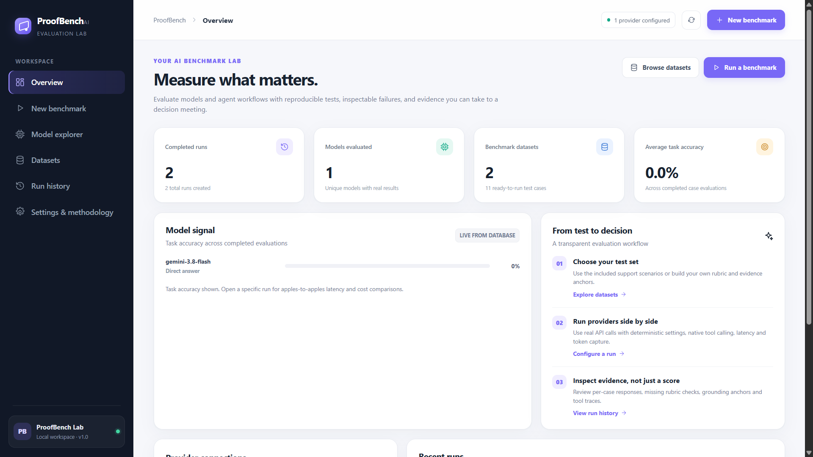
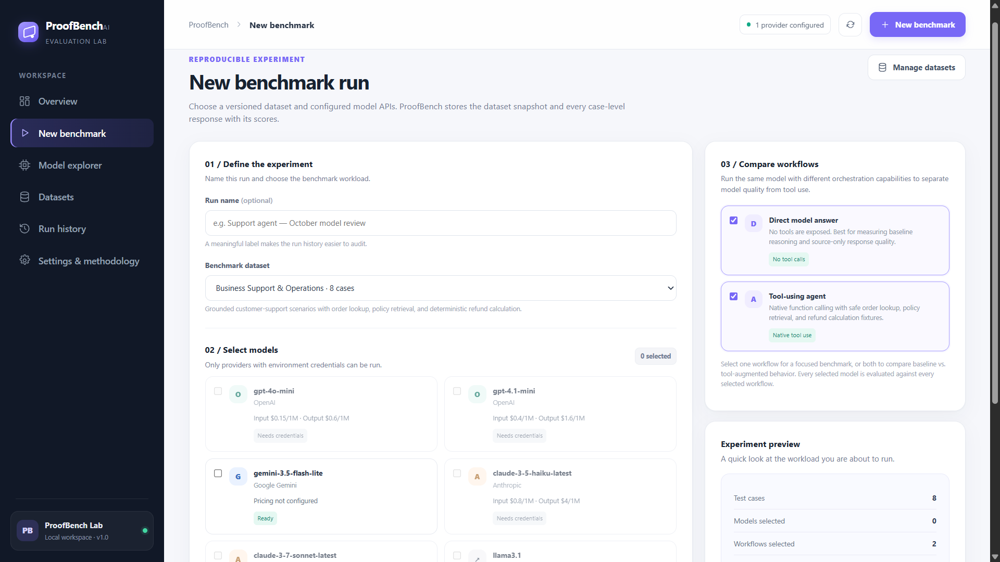
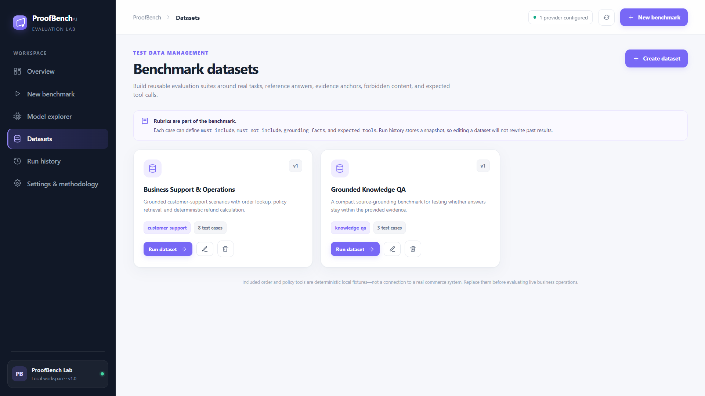
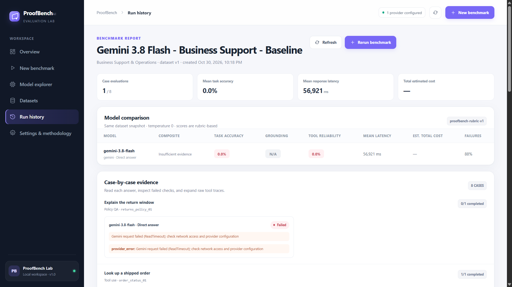

# ProofBench — AI Evaluation Lab

ProofBench is a full-stack evaluation workspace for comparing LLMs and tool-using agent workflows on repeatable business tasks. It is built to turn a model demo into inspectable engineering evidence: a versioned dataset, real provider calls, case-level rubrics, latency and token accounting, tool traces, failure explanations, historical reports, and a cautious recommendation.

**No scores are seeded or fabricated.** A new install contains reusable benchmark datasets, but the dashboard remains empty until you run real evaluations against a configured provider. Dataset order records are explicitly local fixtures; they are not a connection to a live commerce system.


## 📸 Application Screenshots

### 1. Overview Dashboard
Monitor benchmark activity, evaluated models, datasets, and performance metrics.



### 2. Benchmark Configuration
Configure reproducible experiments by selecting datasets, models, and evaluation workflows.



### 3. Dataset Management
Manage configurable datasets and test cases for business-oriented AI evaluations.



### 4. Evaluation Report
Inspect model comparisons, scoring evidence, response latency, failures, and cost information.




## What is included

- **Dashboard and run history:** database-backed KPIs, historical task-accuracy signal, current status, per-run reports, and saved case responses.
- **Real provider adapters:** OpenAI Chat Completions, Google Gemini `generateContent`, Anthropic Messages, and an OpenAI-compatible endpoint adapter for supported hosted gateways or local inference servers.
- **Native function/tool loops:** each adapter can invoke an allow-listed tool, execute it on the backend, pass the result back to the model, and record the trace. Included tools are `lookup_order`, `get_policy`, and `calculate_refund`.
- **Configurable datasets:** create/edit/delete datasets in the UI or API. Each test case supports reference answers, required phrases, forbidden phrases, evidence anchors, expected tools, tags, and context.
- **Reproducible run snapshots:** a run stores the dataset case snapshot and version, selected models, evaluator version, temperature setting, responses, tool calls, token usage, cost-rate source, latency, and case-level failures. Later dataset edits do not modify older reports.
- **Evidence-driven report:** compares model and workflow candidates on the same run, displays case-level response cards, missing checks, tool-use failures, raw tool traces, operational metrics, and a bounded recommendation with caveats.
- **Workflow comparison:** each selected model can be evaluated in two modes in the same run: `direct` (no tools exposed) and `tool_agent` (native function calling with the local tool registry). Select either workflow or both to separate baseline model behavior from the impact of tool access.
- **SQLite persistence, tests, environment-only secrets, modular adapters, Dockerfile, and API docs.**

## Architecture

```text
Browser UI (vanilla JS, CSS, accessible HTML)
       │ same-origin JSON API
       ▼
FastAPI routes / schemas
       ├── Dataset service ─────────────┐
       ├── Run coordinator              │
       │    ├── Provider registry       │
       │    │    ├── OpenAI adapter     │
       │    │    ├── Gemini adapter     │
       │    │    ├── Anthropic adapter  │
       │    │    └── OpenAI-compatible  │
       │    ├── Allow-listed tools      │
       │    └── Rubric evaluators       │
       └── SQLite repository ◄─────────┘
```

The backend currently uses a bounded in-process background task for each run, which is straightforward for a local portfolio application. Case results are persisted one at a time, and a provider failure for one case does not prevent the rest of the benchmark from running. A process restart can interrupt a current run; interrupted runs are marked accordingly on startup. For production or concurrent team usage, move run execution to a durable queue/worker (for example, Celery, Dramatiq, or a cloud job system), use PostgreSQL, add user authentication and tenant isolation, and apply provider-specific rate limits.

## Run locally (Windows PowerShell)

Requirements: Python 3.11+ recommended. Internet access is needed for hosted provider API calls; the app and included local fixtures work without provider credentials.

```powershell
cd proofbench
py -3.11 -m venv .venv
.\.venv\Scripts\Activate.ps1
python -m pip install --upgrade pip
python -m pip install -r requirements.txt
Copy-Item .env.example .env
```

Edit `.env` and add **at least one** provider API key. Then start the application so Uvicorn loads the environment file:

```powershell
uvicorn app.main:app --reload --env-file .env
```

Open these local addresses:

- UI: <http://127.0.0.1:8000>
- OpenAPI / interactive API docs: <http://127.0.0.1:8000/docs>
- Health: <http://127.0.0.1:8000/api/health>
- Methodology: <http://127.0.0.1:8000/api/methodology>

Linux/macOS setup uses the same sequence with `python3 -m venv .venv`, `source .venv/bin/activate`, and `cp .env.example .env`.

### Provider configuration

| Provider | Environment variable | Notes |
|---|---|---|
| OpenAI | `OPENAI_API_KEY` | Uses Chat Completions and native function calling. |
| Google Gemini | `GOOGLE_API_KEY` or `GEMINI_API_KEY` | Uses `generateContent` and function declarations. |
| Anthropic | `ANTHROPIC_API_KEY` | Uses Messages API and native tool-use blocks. |
| OpenAI-compatible | `OPENAI_COMPATIBLE_BASE_URL` | Optional `OPENAI_COMPATIBLE_API_KEY`; local endpoint must support `/chat/completions`. |

Model IDs are configurable with `PROOFBENCH_OPENAI_MODELS`, `PROOFBENCH_GEMINI_MODELS`, `PROOFBENCH_ANTHROPIC_MODELS`, and `PROOFBENCH_COMPATIBLE_MODELS`. Confirm that the model names and function-calling features are supported by your account/endpoint. API availability and aliases change over time, so the example IDs should be treated as editable defaults, not a guarantee of account access.

**Local-model note:** the `OPENAI_COMPATIBLE_BASE_URL` adapter expects a compatible Chat Completions endpoint. For example, a local Ollama endpoint is commonly configured as `http://localhost:11434/v1`, but tool-call support depends on the selected model and serving version. If native tool calling is unsupported, disable tools in the benchmark UI or use another model for tool-reliability tests.

### Cost rate card

The bundled USD rates are **illustrative estimates**, not a current provider quote or invoice. Before using cost data for business decisions, update the rate card to match the current provider pricing, modality, region, caching, and any other billing rules relevant to your workload.

Use `PROOFBENCH_MODEL_PRICING_JSON` in `.env` to override a model's per-million-token input and output rates (one-line JSON):

```dotenv
PROOFBENCH_MODEL_PRICING_JSON={"gpt-4o-mini":{"input_per_1m":0.15,"output_per_1m":0.60},"my-model":{"input_per_1m":0.20,"output_per_1m":0.80}}
```

The values above are syntax examples only; replace them with rates verified for your account and model. If token usage is not reported by a compatible provider or no rate is known, the UI shows cost as unavailable rather than implying zero cost. In that case, token estimates are not silently substituted for measured usage.

## First benchmark

1. Start ProofBench with one provider key configured.
2. Open **New benchmark**.
3. Select `Business Support & Operations` to test policy answers, order lookup, refund calculation, privacy handling, and tool use; or choose `Grounded Knowledge QA` for source-bound question answering.
4. Select one or more configured models. Only models with their provider configured are enabled.
5. Choose `Direct model answer`, `Tool-using agent`, or both. Selecting both runs the same cases in each workflow for each selected model, making the tool-use contribution directly comparable.
6. Open the run report. Watch result progress, compare models on the same test cases, inspect response-level failures, and expand tool traces.

The settings page explains the metric definitions and model pricing. The benchmark tool records every tool call and runs only the allow-listed local implementations in `app/tools.py`. It does not perform real refunds, send messages, or mutate external systems.

## Creating a dataset

Use **Datasets → Create dataset** in the UI. The cases editor accepts a JSON array. Minimal example:

```json
[
  {
    "id": "policy_001",
    "title": "Return deadline",
    "category": "Policy QA",
    "prompt": "Tell the customer the return deadline.",
    "context": "Returns are accepted within 30 calendar days of delivery.",
    "reference_answer": "Returns are accepted within 30 calendar days of delivery.",
    "must_include": ["30 calendar days"],
    "must_not_include": ["60 days"],
    "grounding_facts": ["30 calendar days"],
    "expected_tools": [],
    "tags": ["grounding"]
  }
]
```

Case fields:

- `id`, `title`, `prompt`: required, unique case identity and task.
- `context`: authoritative case context sent with the prompt.
- `reference_answer`: optional fallback for token-overlap F1 if `must_include` is empty.
- `must_include`: phrases the response should contain; task-accuracy score is required-phrase coverage.
- `must_not_include`: forbidden phrases that incur a clear accuracy penalty and failure entry.
- `grounding_facts`: evidence anchors expected to exist in the case context or tool outputs and be reflected in the response.
- `expected_tools`: expected names from the allow-list (`lookup_order`, `get_policy`, `calculate_refund`).
- `tags`: free-form labels for organization.

Dataset updates create a new version. Runs preserve a complete copy of the case definitions as of run creation. For stronger reproducibility, keep test prompt changes under version control and record provider, model alias, region, and rate-card details alongside any experiment used in a formal report.

## Metrics and interpretation

| Metric | What ProofBench computes | Important limitation |
|---|---|---|
| Task accuracy | Required phrase coverage, penalized for forbidden phrases; fallback token F1 against the reference when required phrases are absent. | A transparent deterministic rubric, not a semantic judge. Good rubric coverage matters. |
| Grounding | Fraction of configured evidence anchors present in the supplied context or observed tool outputs and reflected in the answer. | Lexical anchor coverage, **not** entailment and not a complete hallucination detector. |
| Tool-use reliability | F1 of expected versus observed tool names, multiplied by the success rate of invoked local tools. | Reliability reflects the tool expectations in your dataset and the included local fixture registry. |
| Latency | Wall-clock elapsed time for the full provider turn, including native tool-call rounds and network time. | Affected by network, region, provider load, warmup, run order, and stochastic serving infrastructure. |
| Cost | Provider-reported input/output tokens multiplied by the configured per-million-token rates. | Estimates depend on a correct, current rate card and provider usage reporting. |
| Composite | Accuracy 40%, grounding 30%, tool reliability 20%, latency efficiency 5%, cost efficiency 5%; weights are renormalized when not applicable, then the score is discounted by the model's failed-case rate. | Latency/cost efficiency are normalized against the other models in the same run. Treat the composite as a decision aid, not a universal leaderboard. |

Temperature is set to 0 in the included adapters. This helps reduce variance but cannot guarantee identical outputs, tool plans, provider versions, or backend execution. For stronger experimental design, repeat runs, randomize model order, expand datasets, compare confidence intervals, add a suitable semantic judge with human-validated calibration, and test against real business outcomes.

## API overview

- `GET /api/health`
- `GET /api/dashboard`
- `GET /api/models` and `GET /api/settings`
- `GET /api/datasets`, `GET /api/datasets/{id}`, `POST /api/datasets`, `PUT /api/datasets/{id}`, `DELETE /api/datasets/{id}`
- `POST /api/runs`, `GET /api/runs`, `GET /api/runs/{id}`
- `GET /api/methodology`

Use `/docs` for schemas and the interactive API. Example start-run body:

```json
{
  "dataset_id": "ds_support_core",
  "model_ids": ["gpt-4o-mini"],
  "workflow_ids": ["direct", "tool_agent"],
  "name": "Support policy baseline"
}
```

A run returns HTTP `202 Accepted`; poll `GET /api/runs/{id}` for status and results. The run compares each selected model × workflow × dataset case, and each summary identifies both its model ID and workflow ID (`direct` or `tool_agent`). Missing credentials and unknown model IDs are rejected before a run is queued. Individual provider errors are persisted at case level, and the remaining cases continue.

## Tests

```powershell
pytest -q
```

Tests use isolated temporary SQLite databases and do not make paid provider API calls. They cover evaluator math, dataset API versioning/validation, environment-secret handling, unconfigured-provider errors, and the honest empty dashboard state.

## Docker

Build and run (the image listens on port 8000):

```bash
docker build -t proofbench .
docker run --rm -p 8000:8000 --env-file .env -v proofbench-data:/app/data proofbench
```

Persist `/app/data` with a volume. In a real deployment, do not expose the app publicly without authentication, a reverse proxy/TLS, request limits, a secret manager, and a worker strategy appropriate for long-running evaluations.

## Security and extension points

- API keys are read from environment variables and never returned from settings endpoints or stored in SQLite.
- The default UI and API are same-origin and no API keys are submitted from the browser.
- Prompts, contexts, and selected test-case data are sent to the provider you benchmark. Do not put secrets, regulated data, or personal information into test datasets unless your provider agreement, region, and organization's policy explicitly permit it.
- Included tools are allow-listed, local, deterministic and safe for repeatable tests. Never expose arbitrary code execution or unrestricted tools to a model.
- Provider code is isolated under `app/providers/`; tool definitions/dispatch are in `app/tools.py`; rubric logic is in `app/services/evaluation.py`; run execution is in `app/services/benchmark.py`.
- Add a provider by implementing the `ModelProvider` protocol, registering the provider and its model catalog in `app/providers/registry.py`, and adding provider-specific environment configuration.
- Add a metric by extending the versioned evaluator in `app/services/evaluation.py`, adding persisted result fields if needed, updating the methodology endpoint and tests, and bumping the evaluator version so historical results remain interpretable.
- Add an agent framework by adapting its invocation and tool-call trace into the common `ProviderResponse` shape, or introduce a versioned workflow adapter in the benchmark service.

## License

MIT — see `LICENSE`.
